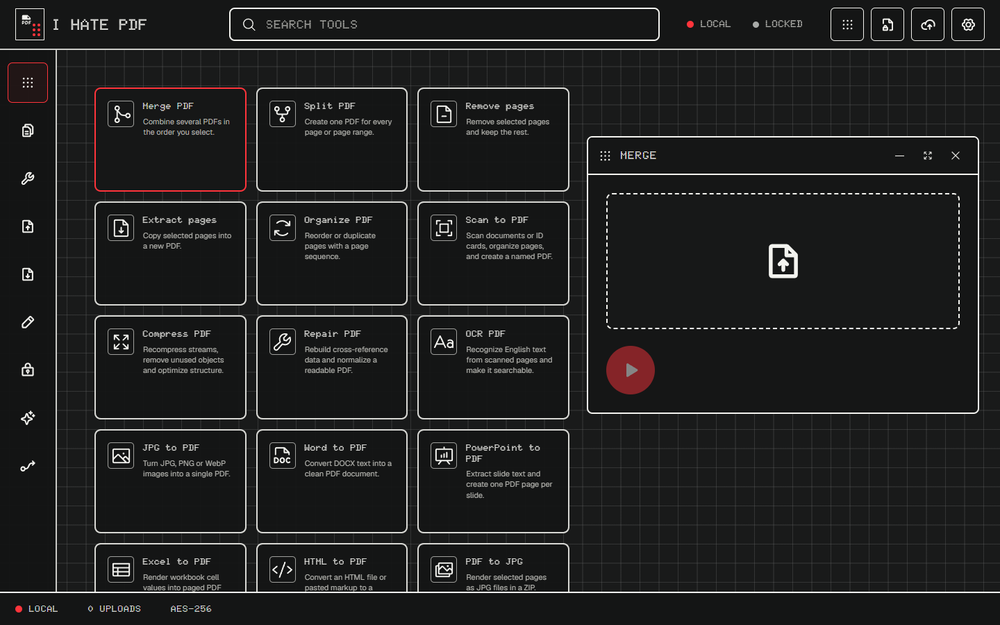
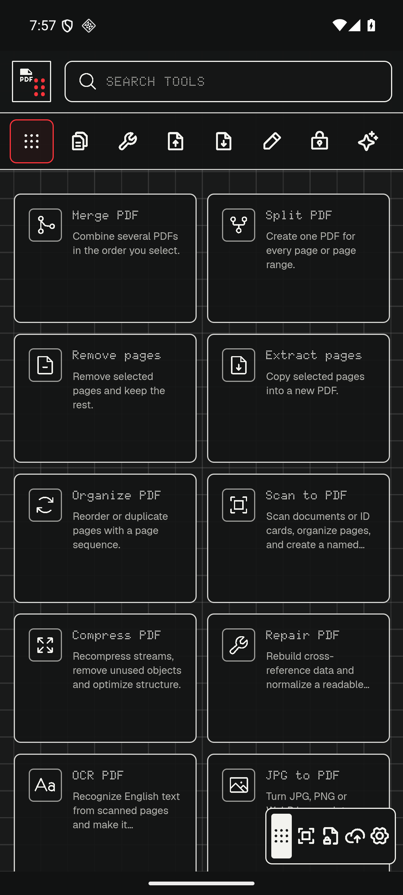
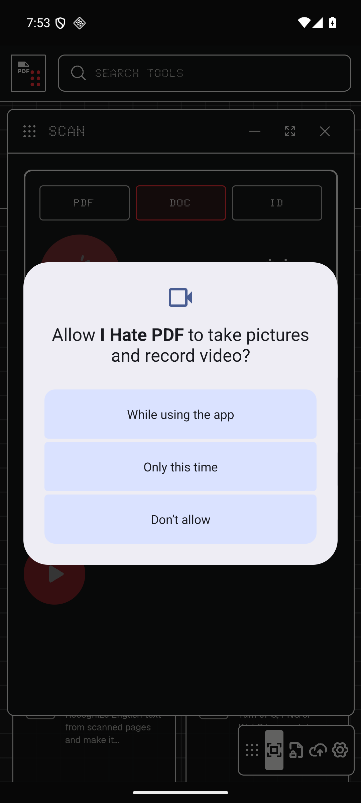

<div align="center">
  

  # I Hate PDF

  **34 local-first PDF tools for desktop and Android.**<br>
  Nothing-inspired UI, encrypted vault, biometric unlock, native document scanning, and manual private-cloud sync.

  [](https://github.com/Reuxbite/i-hate-pdf/actions/workflows/ci.yml)
  [](https://reuxbite.github.io/i-hate-pdf/)
  [](https://github.com/Reuxbite/i-hate-pdf/releases)
  [](LICENSE)

  [Try the web demo](https://reuxbite.github.io/i-hate-pdf/) · [Download the Android test APK](https://github.com/Reuxbite/i-hate-pdf/releases/tag/v0.1.0-test) · [Read the roadmap](ROADMAP.md) · [Contribute](CONTRIBUTING.md)
</div>



## Why this exists

Most online PDF tools begin with an upload. I Hate PDF begins with the opposite rule: the document stays on your device unless you deliberately export it or upload an encrypted vault envelope. There is no conversion server, analytics pipeline, auto-save, or background cloud sync in this repository.

The web app is the complete desktop workspace. The Android build uses the same tool catalogue and adds a native PDF, document, and ID-card scanner, secure storage, file sharing, and biometric vault unlock.

## Highlights

- **34 named tools** across organize, optimize, convert, edit, security, intelligence, and workflow categories.
- **Local processing** with PDF.js, pdf-lib, QPDF WebAssembly, Tesseract.js, and browser-native APIs.
- **Encrypted vault** using PBKDF2-SHA-256 and AES-GCM-256 with authenticated metadata.
- **Android biometric unlock** around the vault password stored through platform secure storage.
- **Native Android scanner** for multi-page PDF/DOC capture and two-sided ID-card capture, with rename, reorder, remove, and add-page actions.
- **Manual private cloud** through a user-configured private GitHub repository; only encrypted `.ihpdf` envelopes are eligible for the built-in upload flow.
- **Desktop-first workbench** with searchable tools and independent operation windows, plus a compact responsive layout for phones.

| Android home | Native scanner permission |
| --- | --- |
|  |  |

## Tool catalogue

| Area | Tools |
| --- | --- |
| Organize | Merge, Split, Remove pages, Extract pages, Organize, Scan to PDF |
| Optimize | Compress, Repair, OCR |
| Convert to PDF | Images, Word, PowerPoint, Excel, HTML |
| Convert from PDF | JPG, Word, PowerPoint, Excel, PDF/A |
| Edit | Rotate, Page numbers, Watermark, Crop, Add text, Fill forms |
| Security | Protect, Unlock, Visual signature, Permanent redaction, Compare |
| Intelligence | Local summary, Browser translation, PDF to Markdown |
| Workflow | Repair with optional rotation, page numbers, and watermark |

## Privacy boundary

```text
Original PDF ──> browser / Android WebView memory ──> local result
                            |
                            +──> AES-GCM encrypted vault envelope
                                      |
                                      +──> optional manual upload
                                           to your private GitHub repo
```

- The project has no application server.
- A web cloud token is kept in `sessionStorage`; Android uses secure storage.
- Repository coordinates are non-secret and kept locally.
- Original files are never automatically uploaded by the built-in cloud flow.
- Android backup is disabled for application data.

Read [SECURITY.md](SECURITY.md) before reporting a security issue, and use GitHub's private vulnerability-reporting flow for sensitive evidence.

## Run the web app

Requirements: Node.js 22 or newer and npm.

```bash
git clone https://github.com/Reuxbite/i-hate-pdf.git
cd i-hate-pdf
npm ci
npm run dev
```

Open `http://127.0.0.1:4173`.

Production checks:

```bash
npm test
npm run build
npm run preview
```

## Build Android

Install JDK 21 and an Android SDK, then run:

```bash
npm ci
npm run android:sync
cd android
./gradlew assembleDebug
```

On Windows, use `gradlew.bat assembleDebug`. The output is written to `android/app/build/outputs/apk/debug/app-debug.apk`.

The downloadable `v0.1.0-test` APK is a **debug-signed test build**, not a production release. It was built and exercised on an Android API 36 emulator. The camera scanner and biometric prompt still need broader physical-device validation before a signed stable release.

## Configure the optional private vault

1. Create a separate **private** GitHub repository for encrypted vault objects.
2. Create a fine-grained token restricted to that repository with **Contents: read and write** only.
3. Open **Cloud** in I Hate PDF and enter the owner, repository, branch, folder, and token.
4. Encrypt a document into the local vault.
5. Choose **Upload** on that one encrypted item when you want it in the private repository.

Nothing uploads automatically. Do not reuse a broad classic token or place a token in source code, an issue, a screenshot, or a configuration file.

## Honest capability boundaries

This project exposes a broad iLovePDF-style catalogue, but browser-only conversion cannot reproduce every proprietary cloud renderer:

- PDF/A is marked desktop-companion-only; valid archival output requires Ghostscript and veraPDF validation.
- DOCX, PPTX, and XLSX conversions are structural and do not reproduce all layout, animation, chart, macro, or proprietary-rendering behavior.
- **Sign** creates a visual signature, not a certificate-backed cryptographic signature.
- Translation uses the browser's on-device Translator API when available; there is no paid remote fallback.
- Compression currently optimizes PDF object and stream structure rather than downsampling embedded images.

These limits are shown in the interface beside affected tools.

## Project map

- [`src/data/tools.ts`](src/data/tools.ts) — searchable tool registry and capability notes.
- [`src/lib/pdfOperations.ts`](src/lib/pdfOperations.ts) — local PDF operations.
- [`src/lib/vault.ts`](src/lib/vault.ts) — encrypted local vault.
- [`src/lib/github.ts`](src/lib/github.ts) — explicit encrypted-envelope sync.
- [`android/app/src/main/java/dev/ihatepdf/app/DocumentScannerPlugin.java`](android/app/src/main/java/dev/ihatepdf/app/DocumentScannerPlugin.java) — native scanner bridge.
- [`docs/ARCHITECTURE.md`](docs/ARCHITECTURE.md) — system boundaries and data flow.

## Verification

The current implementation has passed unit tests, a TypeScript/Vite production build, responsive Chromium checks, local browser merge/protect/vault flows, Capacitor synchronization, Android debug assembly, and API 36 emulator navigation/scanner-permission checks. The exact caveat is important: dynamic scanner capture and real biometric authentication have not yet been proven across physical devices.

## Contributing and license

Read [CONTRIBUTING.md](CONTRIBUTING.md) for local checks and the project's privacy and design constraints. The roadmap includes image-aware compression, localization, physical-device testing, and an optional standards-validated desktop companion.

Licensed under the [MIT License](LICENSE).
